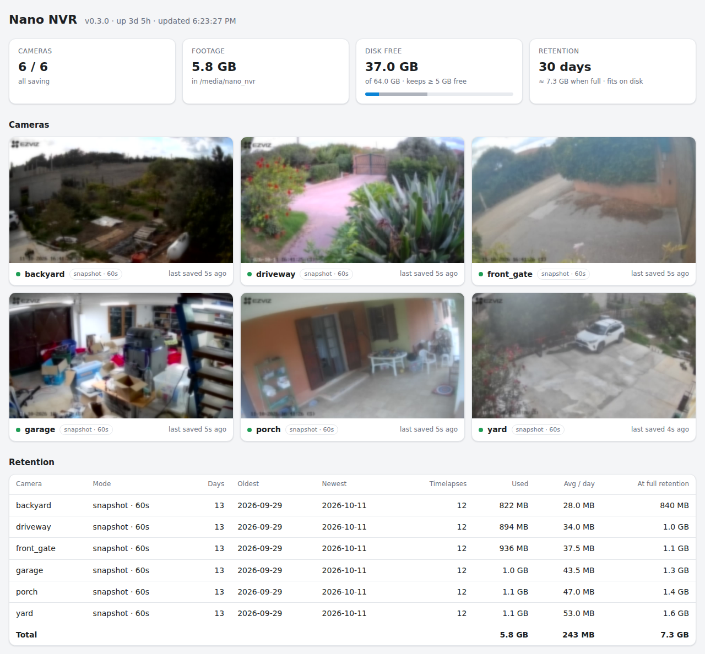
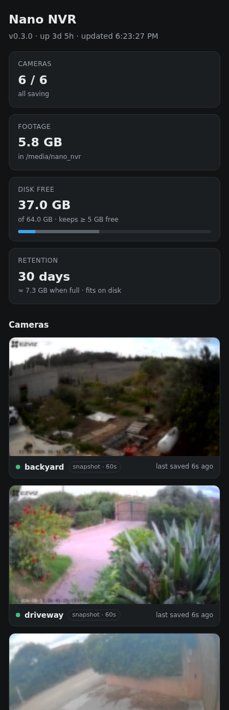

<p align="center">
  
</p>

<p align="center">
  <b>A tiny RTSP camera recorder for Home Assistant.</b><br>
  Keep your footage at home: no vendor cloud, no SD cards, almost no CPU.
</p>

<p align="center">
  <a href="https://my.home-assistant.io/redirect/supervisor_add_addon_repository/?repository_url=https%3A%2F%2Fgithub.com%2Ffborraccetti%2Fnano-nvr"></a>
</p>



## Why

Most consumer IP cameras (EZVIZ, Tapo, Imou, Reolink, ...) store their footage
either in the vendor cloud or on an SD card inside the camera. The first sends
video of your home to someone else's servers, the second is lost together
with the camera it is in.

Full NVRs such as Frigate fix that, but they decode every stream all the time
and work best with a GPU or a Coral accelerator. If all you want is to know
what happened today, that is a lot of machinery.

Nano NVR does the minimum: it pulls the stream over your LAN, writes plain MP4
and JPG files to Home Assistant's `/media` folder and cleans up after itself.

## What it does

* **Snapshot mode** (default): one keyframe every N seconds per camera. After
  midnight the frames of the day become one H.264 timelapse (about a minute of
  video per day with the defaults) and the JPGs are deleted. The stream is
  opened only for the shot, so between two shots the cost is zero.
* **Record mode**: continuous recording in MP4 segments, copied from the
  camera without re-encoding. Optionally re-encoded at a lower frame rate.
* **Retention**: keeps N days, and deletes the oldest days first when free
  space runs low. Today's files are never touched.
* **Sidebar panel**: preview mosaic, status of every camera, storage and
  retention per camera, current settings.
* **Plain files**: browse and play everything from the Home Assistant
  **Media** panel, copy it over Samba, back it up with whatever you like.

| | |
| --- | --- |
|  | **Works on the phone too.** The panel follows the light or dark theme of the device and is served through Home Assistant ingress: it works in the companion app and through remote access, and it opens no port on your network. |

## How light is it

Measured on an x86 machine with three cameras (two in snapshot mode, one in
record mode with stream copy):

| | Nano NVR |
| --- | --- |
| CPU, steady state | about 1 % of one core |
| RAM | about 35 MB |
| Image size | about 175 MB (Alpine, Python, ffmpeg) |
| Disk per camera per day, snapshot mode | 20-50 MB of timelapse |
| Nightly timelapse encoding | 1-2 minutes of CPU per camera, at the lowest priority |

In record mode the CPU stays low because nothing is re-encoded, but disk use
follows the camera bitrate: a 2 Mbit/s stream is about 20 GB per day.

### Compared with the usual options

| | Vendor cloud | SD card | Frigate | **Nano NVR** |
| --- | --- | --- | --- | --- |
| Footage stays at home | no | yes | yes | yes |
| Survives a stolen or broken camera | yes | no | yes | yes |
| Monthly fee | often | no | no | no |
| Decodes every stream all the time | n/a | n/a | yes | no |
| Accelerator recommended | n/a | n/a | yes | no |
| Object detection and alerts | depends on the plan | no | yes | no |

Nano NVR is not a security system: there is no motion or object detection and
no live streaming. If you need alerts, use [Frigate](https://frigate.video).
If you want to see what your cameras saw today, every day, for weeks, on
modest hardware, Nano NVR is enough.

## Installation

1. Click the button above, or go to **Settings → Add-ons → Add-on store →
   ⋮ → Repositories** and add `https://github.com/fborraccetti/nano-nvr`.
2. Install **Nano NVR**. Home Assistant builds the image locally, which takes
   a few minutes the first time.
3. Open the **Configuration** tab, switch to **Edit in YAML** and add your
   cameras:

   ```yaml
   cameras:
     - name: driveway
       url: rtsp://192.168.1.21:554/ch1/main
       username: admin
       password: ABCDEF
     - name: garage
       url: rtsp://192.168.1.22:554/ch1/main
       username: admin
       password: GHIJKL
       interval: 30
   ```

   Only `name` and `url` are required. The defaults are a good start:
   snapshot mode, one shot per minute, 30 days of retention.
4. **Start** the add-on and check the **Log** tab: there is one line per camera.
5. Open **NVR** in the sidebar. Files appear under **Media → My media →
   nano_nvr**.

Before the first night, have a look at **Settings → System → Backups**:
Home Assistant backups include `/media` by default, which gets heavy with weeks
of footage.

### Finding the RTSP URL of your camera

| Brand | Main stream | Sub-stream |
| --- | --- | --- |
| EZVIZ, Hikvision | `/Streaming/Channels/101` or `/ch1/main` | `/Streaming/Channels/102` or `/ch1/sub` |
| Dahua, Amcrest | `/cam/realmonitor?channel=1&subtype=0` | `/cam/realmonitor?channel=1&subtype=1` |
| Reolink | `/h264Preview_01_main` | `/h264Preview_01_sub` |
| TP-Link Tapo | `/stream1` | `/stream2` |

On EZVIZ cameras RTSP must be enabled in the EZVIZ app first; the user is
`admin` and the password is the verification code on the camera label. Some
models answer only on `rtsp://IP:554` with no path. Test the URL with VLC
(**Media → Open Network Stream**) before adding it.

### Going cloud-free

Once Nano NVR records your cameras you can take the SD cards out and block
internet access for the cameras on your router. Their apps stop working away
from home; Home Assistant takes over for live view and remote access.

## Documentation

Every option, the storage layout, codec notes and troubleshooting are in
[nano_nvr/DOCS.md](nano_nvr/DOCS.md), which is also shown in the
**Documentation** tab of the add-on.

## Development

```sh
# unit tests, standard library only
python3 -m unittest discover -s tests -v

# run against real cameras without Home Assistant
python3 nano_nvr/app/nano_nvr.py --options my-options.json

# serve the panel on sample data (used for the screenshots)
python3 tools/demo_panel.py path/to/one-jpg-per-camera/

# build the add-on image
docker build --build-arg BUILD_VERSION=dev -t nano-nvr nano_nvr
```

`my-options.json` uses the same keys as the add-on configuration, as JSON, with
`storage_path` pointing to a local folder. Environment variables for local
runs:

* `FFMPEG`: path of a different ffmpeg binary;
* `NANO_NVR_PANEL_PORT`: panel port (default 8099);
* `NANO_NVR_PANEL_OPEN=1`: accept panel requests from any address, not only
  from the Home Assistant ingress proxy (handy inside Docker);
* `NANO_NVR_PREVIEW_DIR`: where live previews are cached (default
  `/tmp/nano_nvr_preview`).

## License

MIT, see [LICENSE](LICENSE).
